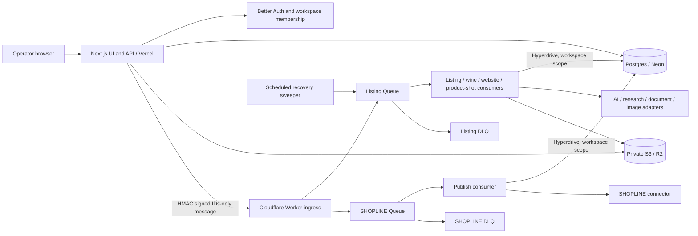

# Architecture

This describes the checked-in runtime. Deployment identity and health must be
verified separately. Start with [README.md](README.md) for commands and links.

## Runtime and trust boundaries

The deployable Worker entry is [`cloudflare.ts`](apps/worker/src/cloudflare.ts):
`fetch` handles signed ingress, `queue` dispatches consumers and `scheduled` runs
recovery. Website, wine and product-shot messages share the listing binding;
SHOPLINE delivery has its own Queue and ledger. Web-side website/document
callbacks have their own authenticated boundaries. Local full-stack tests replace
external providers with synthetic adapters but run real HTTP, Queues and storage.

## Core flows and durable ownership

1. **Intake and generation.** Web resolves the server session and workspace,
   validates input and records an accepted operation with its input revision,
   prompt/provider policy and budget before dispatch. Strict Queue envelopes carry
   identifiers, not source files, tokens or generated content. Consumers reload
   authoritative records and claim a lease; duplicate delivery must not execute a
   completed run again. Explicit run attempts distinguish deliberate retries from
   redelivery. See [`listingRunKey`](packages/jobs/src/cloudflare-queue.ts),
   [`listing-consumer.ts`](apps/worker/src/listing-consumer.ts) and
   [`listing-dispatch-outbox.ts`](packages/db/src/repositories/listing-dispatch-outbox.ts).
2. **Review and approval.** Candidates become versioned listings for human review.
   [`transitionListing`](packages/core/src/workflow.ts) controls status changes
   and requires the audit write to succeed. Editing approved, published or
   publish-failed inputs reopens review; editing while processing moves the
   listing to `needs_info`; editing while publishing is forbidden. Manual
   submission can move intake/recovery states to review, but cannot bypass
   approval. Repository transactions own persistence and associated audit events.
3. **Delivery.** [`delivery-policy.ts`](packages/shopline/src/delivery-policy.ts)
   checks the active approved version, compliance, image approval, connection and
   payload binding again before delivery. Workbook/CSV export also checks source
   lineage and freshness; see [daily operations](docs/runbooks/opak-daily-operations.md).
   SHOPLINE delivery claims a version/action key, records the remote product ID
   before the wider local completion transaction, and reconciles that ID on
   redelivery. A platform binding selects create versus update; retries must
   preserve it. See [`publish-product.ts`](apps/worker/src/publish-product.ts).
4. **Recovery.** Retries and lease expiry recover transient work. Consumer policy
   and DLQs are rendered from
   [`cloudflare-runtime.config.json`](cloudflare-runtime.config.json); the
   scheduled sweeper re-enqueues stuck listing work. A Queue acceptance response
   is not completion: inspect operation, version, ledger and audit state.

## Invariants to preserve

| Boundary                 | Rule and implementation                                                                                                                                                                                                                                                                |
| ------------------------ | -------------------------------------------------------------------------------------------------------------------------------------------------------------------------------------------------------------------------------------------------------------------------------------- |
| Tenant identity          | Resolve identity/membership in [`session-context.ts`](apps/web/lib/session-context.ts); never trust request JSON for workspace or actor. Middleware cookie checks only help navigation.                                                                                                |
| Database access          | `db.forWorkspace()` starts a transaction and sets transaction-local `app.workspace_id`; RLS and a non-superuser, non-`BYPASSRLS` runtime role enforce isolation. Admin credentials belong only to controlled migration/maintenance jobs. See [`client.ts`](packages/db/src/client.ts). |
| Mutation/audit           | Domain mutations and audit records commit together. Audit failure must prevent a successful transition.                                                                                                                                                                                |
| Ingress                  | HMAC covers timestamp, exact path and raw UTF-8 body; skew is limited to 300 seconds, body to 4 KiB, and schemas reject unknown fields. `202` follows successful Queue send. See [`ingress.ts`](apps/worker/src/ingress.ts).                                                           |
| Redelivery               | HMAC timestamps bound freshness, not replay uniqueness. Persisted run keys, leases and terminal state enforce idempotency. Do not add retries around local completion that repeat remote writes.                                                                                       |
| AI evidence              | User notes, workbook cells, web pages and model output are untrusted. Validate schemas, grounding, immutable facts and accounting; human approval remains necessary. Prompt changes bump [`listing-prompt-versions.ts`](packages/core/src/listing-prompt-versions.ts).                 |
| Objects/secrets          | Objects use workspace-prefixed private keys and scoped signed URLs. Keep provider keys in their owning runtime, never browser variables or logs. Web and Worker storage credentials have separate scopes.                                                                              |
| Deployment compatibility | Shared packages resolve compiled `dist` JavaScript. Web and Worker must agree on envelope and accepted prompt versions. Ship compatible consumers before new producers; drain or pause affected work for incompatible changes.                                                         |

## Testable contracts

See [testing commands and limitations](docs/runbooks/testing.md). The key suites are:

| Contract                                                                 | Regression evidence                                                                |
| ------------------------------------------------------------------------ | ---------------------------------------------------------------------------------- |
| Legal transitions, approval invalidation, manual recovery, audit failure | `packages/core/src/workflow.test.ts`                                               |
| Raw-byte/path authentication, size limits, Queue acceptance failure      | `apps/worker/src/ingress.test.ts`                                                  |
| Publishing and remote/local failure windows                              | `apps/worker/src/publish-product.test.ts`, `shopline-consumer.test.ts`             |
| Tenant isolation and transaction behavior                                | `packages/db/src/**/*.integration.test.ts`                                         |
| HTTP → signed ingress → Queue → durable result                           | `tests/e2e/listing-pilot.spec.ts`; harness guards in `real-stack-boundary.spec.ts` |
| Deployment/configuration constraints                                     | Root `tests/*.test.mjs`, `release-gate:check`                                      |

## Short risk map

These are residual risks, not claims of a currently observed incident.

| Priority | Risk / failure mode                                                | Existing control                                                         | Remaining exposure                                                                                                     |
| -------- | ------------------------------------------------------------------ | ------------------------------------------------------------------------ | ---------------------------------------------------------------------------------------------------------------------- |
| High     | Tenant data exposed by wrong identity or privileged runtime role   | Server membership, workspace transactions, RLS, integration tests        | Role drift and deployed configuration need independent verification.                                                   |
| High     | Duplicate remote write or paid generation after timeout/redelivery | Leases, stable operation keys, remote-ID ledger and reconciliation tests | Remote success before local ID persistence remains an ambiguous window; unknown provider outcomes need reconciliation. |
| High     | Web/Worker/schema version skew stalls accepted work                | Strict envelopes, prompt pins, compatibility checks and readiness gates  | Two deploy surfaces and manual rollout coordination can still drift.                                                   |
| Medium   | Queue backlog or exhausted retries leave operations stuck          | Scheduled sweeper, bounded retries and separate DLQs                     | Monitoring ownership, replay procedure and recovery time require operational evidence.                                 |
| Medium   | Unsupported AI claims or incomplete billing evidence               | Grounding, accounting validation, budgets and human review               | Synthetic tests do not prove live model quality or account-level spend; failed/unknown calls need ledger coverage.     |

## Next three engineering investments

1. **Make release compatibility an automated gate.** Record web SHA, Worker SHA,
   migration set and prompt/envelope versions in one release manifest; verify it
   against both deployed surfaces before resuming admission. Success: a mixed
   release is detected and blocked in a synthetic rollout/rollback test.
2. **Close ambiguous side-effect recovery and observability gaps.** Persist and
   reconcile unknown provider/publish outcomes; correlate operation IDs with
   Queue age, lease expiry, DLQ entries and usage. Assign alert/replay owners.
   Success: an injected remote-success/local-failure scenario recovers without a
   duplicate write, and an exhausted job produces an actionable alert.
3. **Make isolated acceptance tests easy to reproduce.** Standardize disposable
   database creation/identity guards and fixture teardown across integration and
   browser cohorts; retain fast unit checks and a small required full-stack gate.
   Success: one documented command provisions synthetic dependencies and proves
   auth, workspace isolation, intake → approval → export/publish and recovery
   without customer data or paid calls.
